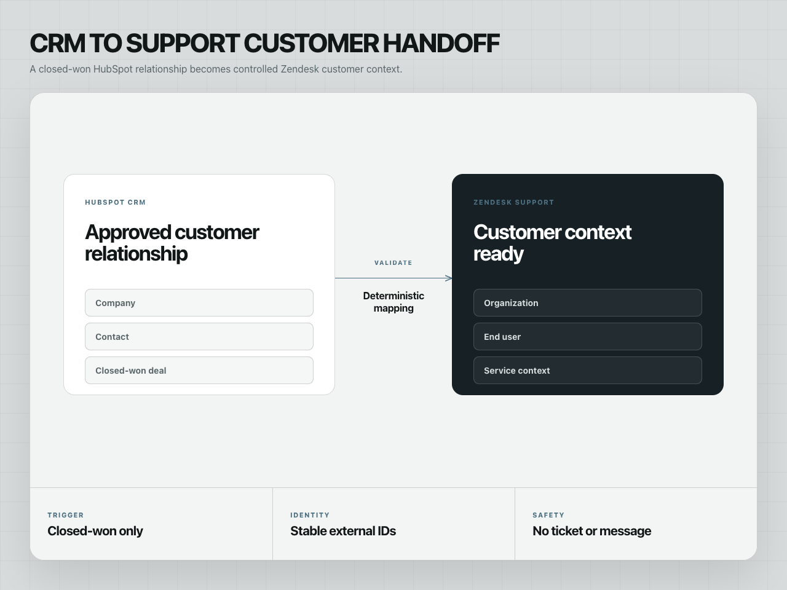
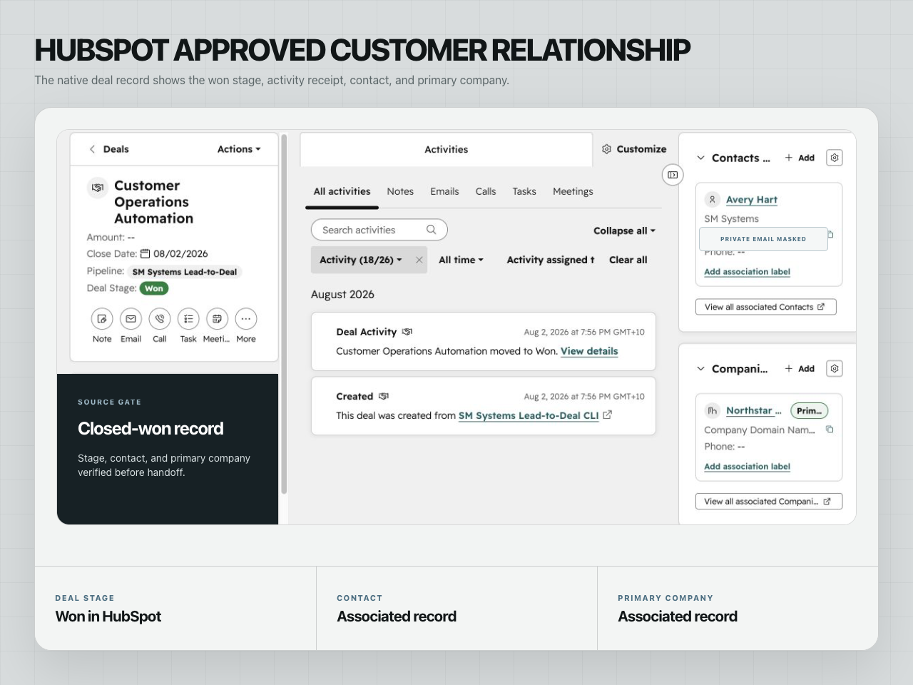
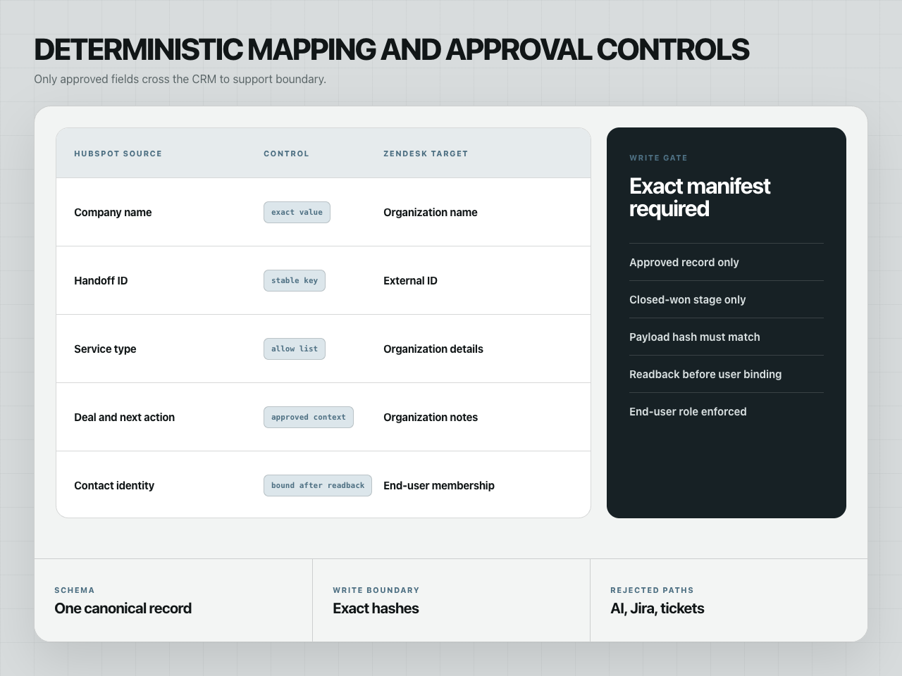
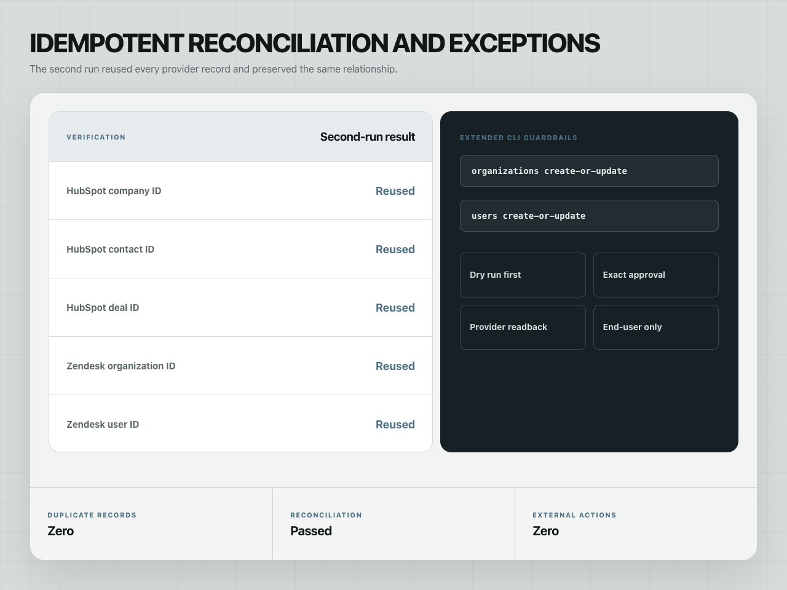

# HubSpot to Zendesk customer handoff

A controlled SM Systems implementation showing how an approved won relationship
can move from HubSpot into Zendesk without duplicate organizations, duplicate
end users, or unreviewed customer communication.

The build maps one synthetic company, contact, and closed-won deal into one
Zendesk organization and one linked end user. Stable external IDs, exact
approval gates, provider readback, an idempotent rerun, and cross-system
reconciliation keep the handoff inspectable.

**Role:** CRM-to-support architecture, field mapping, approval controls, provider integration and reconciliation. **Status:** an internal SM Systems implementation verified with controlled commissioning records.

[View the combined CRM and handoff case study](https://smsystems.au/work/hubspot-lead-to-deal-crm/)

## What this proves

- deterministic HubSpot company, contact, deal, and association planning;
- explicit CRM-to-support field mapping;
- organization-before-user sequencing in Zendesk;
- stable-key matching and duplicate-safe replay;
- provider readback and cross-provider reconciliation;
- CLI commands for planning, binding, and reconciliation;
- five controlled proof frames, including native HubSpot and Zendesk views.

## Proof package

All records shown below are synthetic, provider-backed SM Systems records. The
contact alias is masked in the public images.










## Local validation

```bash
python3 -m venv .venv
source .venv/bin/activate
python -m pip install -e .
make validate
```

Generate a deterministic local plan from the included controlled example:

```bash
make plan
```

The generated files are written to `build/plan/` and are ignored by Git.

## CLI surfaces

```text
customer-handoff plan       Generate deterministic HubSpot and Zendesk payloads
customer-handoff bind-user  Bind a read-back Zendesk organization ID
customer-handoff reconcile  Verify HubSpot and Zendesk provider readbacks
```

## Claim boundary

This repository demonstrates a controlled implementation using synthetic
records. It does not claim a paid-client deployment, production traffic,
Zendesk ticket automation, customer replies, AI or RAG, Jira escalation,
measured time savings, revenue, or ROI.
