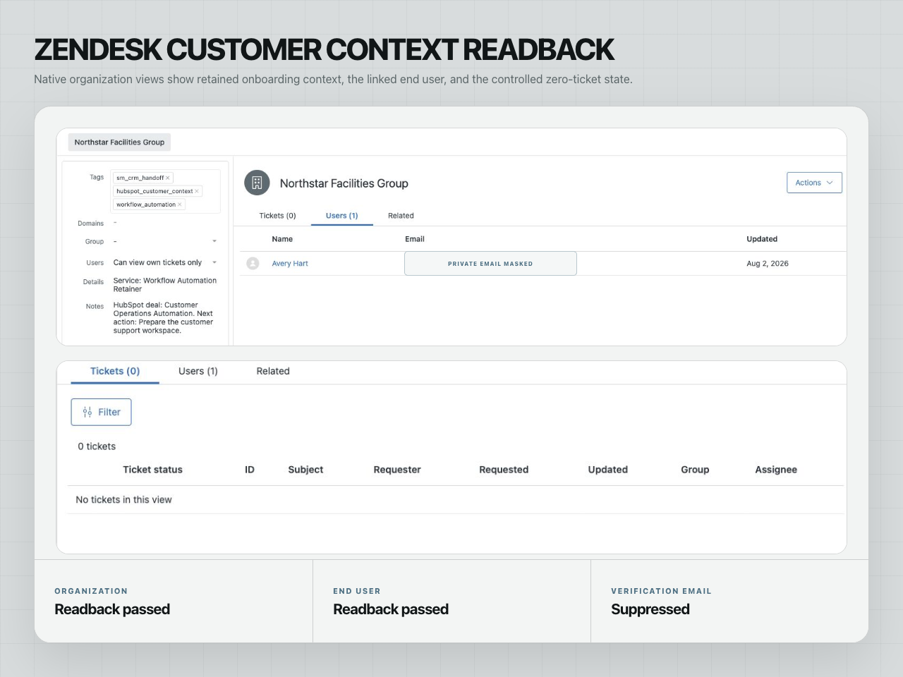

# HubSpot to Zendesk Customer Handoff

Move an approved won relationship from HubSpot into Zendesk with stable identity matching, duplicate-safe replay and provider readback.

**Status:** internal implementation commissioned with controlled synthetic records.

**My contribution:** CRM-to-support architecture, field mapping, approval controls, provider integration and reconciliation.

[Architecture](docs/architecture.md) · [Case study](docs/case-study.md) · [Runbook](docs/runbook.md)



*August 2026 commissioning summary with native Zendesk captures and a masked contact alias. Further [screens and provenance](docs/evidence.md) cover the HubSpot source, mapping and reconciliation.*

## How it works

1. Bind one synthetic HubSpot company, contact and closed-won deal.
2. Prepare the organization before the end user.
3. Match stable external IDs and require approval before provider changes.
4. Bind the read-back organization ID to the user.
5. Reconcile both providers and verify that a rerun does not duplicate records.

The local engine produces deterministic plans. Provider commissioning records document the controlled cross-system result; they are distinct from a local plan's successful validation.

## Implementation

The public package includes planning and reconciliation code, contracts, synthetic examples, tests and sanitized commissioning views. The commands are:

```text
customer-handoff plan       Prepare provider payloads
customer-handoff bind-user  Bind a read-back organization ID
customer-handoff reconcile  Compare provider readbacks
```

Generate a plan without provider writes:

```bash
python3 -m venv .venv
source .venv/bin/activate
python -m pip install -e .
make plan
```

Outputs go to the ignored `build/plan/` directory.

## Validation

```bash
make validate
```

This runs the engine tests and public-package checks. The [runbook](docs/runbook.md) explains the separate provider approval, readback and reconciliation steps.

## Scope and current state

This is an internal workflow using synthetic provider-backed records. It does not implement ticket replies, AI/RAG, Jira escalation or production customer onboarding, and it does not claim measured savings or revenue.

## Documentation

- [Architecture](docs/architecture.md)
- [Case study](docs/case-study.md) and [combined CRM case study](https://smsystems.au/work/hubspot-lead-to-deal-crm/)
- [Runbook](docs/runbook.md)
- [Evidence index](docs/evidence.md)

MIT. See [LICENSE](LICENSE).
