# Architecture

```mermaid
flowchart LR
    Dataset["Approved controlled relationship"] --> Guard["Validation and approval gates"]
    Guard --> HubSpot["HubSpot company, contact and won deal"]
    HubSpot --> HRead["HubSpot stable-key readback"]
    HRead --> Mapper["CRM-to-support mapping"]
    Mapper --> ZOrg["Zendesk organization upsert"]
    ZOrg --> ZOrgRead["Organization provider readback"]
    ZOrgRead --> ZUser["Zendesk end-user upsert"]
    ZUser --> Reconcile["Cross-provider reconciliation"]
    Reconcile --> Review["Owner-reviewed proof package"]
```

## Control boundaries

- The Python control plane owns validation, deterministic mapping, artifact
  generation, and reconciliation.
- HubSpot remains the relationship source.
- Zendesk remains the controlled customer-context destination.
- The organization is read back before its provider ID can be bound into the
  end-user payload.
- `role=end-user` and `skip_verify_email=true` are enforced by the generated
  user payload.
- No ticket, comment, reply, AI action, Jira action, or customer notification
  belongs to this implementation.

